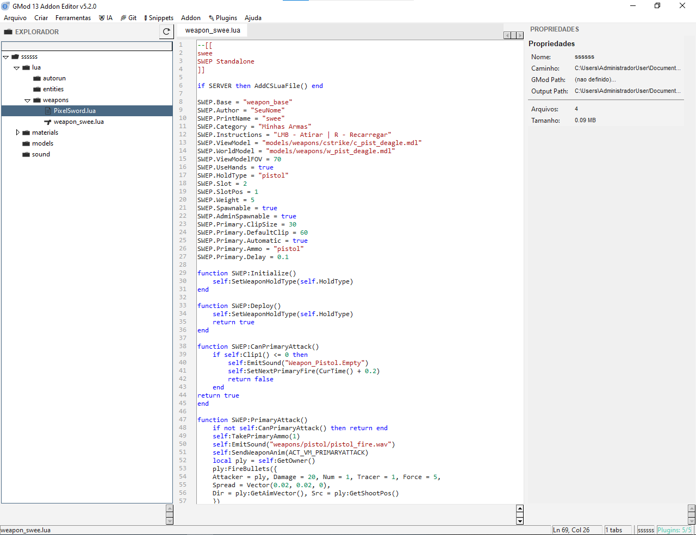

# GMOD 13 EDITOR (GME)

**Um editor de addons completo(ou quase) para Garry's Mod 13 — com ia integrada, tema escuro e claro, sistema de plugins e muito mais.**

---

## Preview

<!--  -->

---

## O que é?

O **GMOD 13 Editor (GME)** é uma ferramenta standalone para **criar, editar e publicar addons** para o **Garry's Mod 13**.

Com uma interface inspirada no **VS Code**, você pode:

- Editar código Lua com syntax highlighting e autocomplete
- Criar SWEPs (armas) a partir de templates prontos
- Criar ENTITYs (VJ Base, DRG Base ou Standalone)
- Importar assets (texturas, modelos, sons) via drag & drop
- Compilar addons direto pra `.gma` (via `gmad.exe`)
- Publicar e atualizar no Steam Workshop
- Usar IA pra corrigir bugs, sugerir melhorias e explicar código
- Alternar entre tema escuro e claro

---

## Funcionalidades

### Editor de Código
- Syntax highlighting completo pra **Lua**
- **Tabs** estilo VS Code (`Ctrl+W` pra fechar)
- **Números de linha** com scroll sincronizado
- **Auto-complete** de funções Lua/GMod (com sugestões de plugins)
- **Linter em tempo real** — valida sintaxe enquanto você digita
- **Formatter** — indentação automática de código Lua

### Explorador de Arquivos
- Navegação completa pelo projeto
- Criar, renomear e deletar arquivos/pastas
- **Drag & Drop** pra importar arquivos
- Detecção inteligente da pasta de destino (por extensão)
- Exportar assets pra `.zip`

### Templates Prontos

| Tipo | Base | Arquivo gerado |
|------|------|----------------|
| SWEP | 308 Base | `weapon_nome.lua` |
| SWEP | Standalone | `weapon_nome.lua` |
| ENTITY | VJ Base | `shared.lua` |
| ENTITY | DRG Base | `shared.lua` |
| ENTITY | Standalone | `shared.lua` + `init.lua` + `cl_init.lua` |

### AI Assistant (Groq)

Todas as funções usam a **API gratuita da Groq**:

- **Corrigir Bug** — encontra e corrige erros no seu código
- **Sugestão** — dá ideias pra melhorar o que você escreveu
- **Explicar Código** — explica em português, linha a linha
- **Modo Iniciante** — explica como se você nunca tivesse usado Lua
- **Gerar Código** — descreva em português e a IA gera
- **Traduzir Comentários** — PT ⇄ EN automaticamente
- **Chat com histórico** — conversas persistentes entre sessões

**Modelos disponíveis:**
- `openai/gpt-oss-120b` (recomendado)
- `llama-3.1-70b-versatile`
- `llama-3.1-8b-instant`
- `gemma2-9b-it`

### Plugins & Marketplace

- Sistema de **plugins em JSON** (autocomplete, keywords, templates)
- **Dependências** entre plugins (`requires: ["gmod_toolkit"]`)
- **Marketplace local** — instale plugins prontos com 1 clique

### Outras Ferramentas

- **Git integrado** — status, commit, push, pull (via CLI)
- **Snippets** — salve e reutilize trechos de código
- **Corrigir erros comuns** — `if x = 5` → `if x == 5`, etc.
- **Visualizador de imagens** com zoom e export
- **Copiar caminhos VPK** com 1 clique (individual ou múltiplos)
- **Auto-save** configurável

---

## Download

Baixe a versão mais recente na página de [**Releases**](https://github.com/lixbot85-dot/gmod13-editor-br/releases/latest).

| Versão | Status | Descrição | Anti-Vírus |
|--------|--------|-----------|
| v5.1.2 | Estável | Git, Snippets e Linter | Passa |
| v4.9 | Antiga | Sem updates ou patchets | Falso-Positivo |

### Requisitos

| Item | Detalhes |
|------|----------|
| **Sistema** | Windows 7 ou superior |
| **Python** | Não precisa (o `.exe` inclui tudo) |
| **Garry's Mod** | Necessário pra compilar/publicar (via `gmad.exe`) |
| **Conexão** | Necessária só pra usar a IA |

---

## Como Usar

### 1. Baixe e execute
Baixe o `GME.exe` da página de [Releases](https://github.com/lixbot85-dot/gmod13-editor-br/releases/latest).

### 2. Coloque em uma pasta separada
pega o GME.exe e coloca em uma pasta separada só para ele (e também coloca a pasta plugins caso tenha junto).

### 3. Configure os caminhos
`Arquivo → Configurações`:
- **Pasta do Garry's Mod** — ex: `C:/Program Files (x86)/Steam/steamapps/common/GarrysMod`
- **Pasta de Output** — onde os `.gma` compilados serão salvos
- **(Opcional)** Groq API Key pra usar a IA

### 4. Crie um projeto
`Arquivo → Novo Projeto` (ou `Ctrl+N`) e dê um nome.

### 5. Comece a criar
- Clique com **botão direito** no explorador
- Escolha `Criar → SWEP/ENTITY` e selecione o template
- Edite o código
- `F5` pra compilar

### 6. Publique
- `F6` pra publicar no Workshop pela primeira vez
- `F7` pra atualizar um addon existente

---

## Atalhos

| Tecla | Ação |
|-------|------|
| `Ctrl+N` | Novo Projeto |
| `Ctrl+O` | Abrir Projeto |
| `Ctrl+S` | Salvar arquivo atual |
| `Ctrl+W` | Fechar tab atual |
| `Ctrl+Q` | Sair |
| `Ctrl+Space` | Alternar auto-complete |
| `Ctrl+Shift+C` | Copiar VPKs selecionados |
| `Ctrl+Tab` | Próxima tab |
| `Ctrl+Shift+Tab` | Tab anterior |
| `F5` | Compilar Addon |
| `F6` | Publicar Addon |
| `F7` | Atualizar Addon |
| `F8` | Recarregar Projeto |
| `F9` | Alternar tema (escuro/claro) |

---

## Suporte a Arquivos

| Tipo | Extensões |
|------|-----------|
| **Lua** | `.lua`, `.txt` |
| **Imagens** | `.png`, `.jpg`, `.jpeg`, `.tga`, `.bmp`, `.gif`, `.webp` |
| **Materiais** | `.vmt`, `.vtf` |
| **Modelos** | `.mdl`, `.vvd`, `.vtx`, `.phy`, `.smd`, `.qc` |
| **Sons** | `.wav`, `.mp3`, `.ogg`, `.flac` |
| **Partículas** | `.pcf` |
| **Outros** | `.zip`, `.json` |

---

## Configurando a IA

1. Acesse [console.groq.com](https://console.groq.com) e crie uma conta (gratuita)
2. Gere uma **API Key**
3. No editor: `Arquivo → Configurações`
4. Cole a chave em **Groq API Key**
5. Selecione o modelo (recomendo `openai/gpt-oss-120b`)
6. **Salvar**

A Groq oferece API gratuita com limite generoso — mais que o suficiente pro dia a dia.

---

## FAQ

<b>O editor é gratuito?</b>

Sim, totalmente. Licença Apache 2.0.

<b>Precisa de Python instalado?</b>

Não. O <code>.exe</code> já inclui tudo que precisa.

<b>A IA é gratuita?</b>

Sim. A Groq oferece API gratuita — só precisa criar uma conta e gerar uma key.

<b>Posso usar sem o 308 Base instalado?</b>

Sim. Os templates <b>Standalone</b> não exigem nenhuma base externa.

<b>O que faço se o <code>gmad.exe</code> não for encontrado?</b>

Verifique se a pasta do Garry's Mod está correta em <b>Configurações</b>. O <code>gmad.exe</code> fica em <code>&lt;GMod&gt;/bin/gmad.exe</code>.

<b>A IA retornou erro de limite de tokens</b>

O editor <b>trunca automaticamente</b> o código quando ele passa do limite. Verifique o indicador na status bar (canto inferior direito) — se estiver vermelho, seu código está grande.

<b>Onde devo colocar?</b>

Você deve colocar em uma pasta separada, o aplicativo cria pastas onde ele estiver caso não tenha.

<b>O meu anti-vírus detectou que é malware, qoue eu faço?</b>

As versões antigas como 4.3 mexe com coisas do sistema, é falso-positivo.
Não recomendo usar versões antigas do GME abaixo de 5.0.4

---

## Troubleshooting

**A janela não abre / fecha sozinha:**
Verifique se você tem permissão de escrita na pasta onde o `.exe` está. Windows pode bloquear.

**Erro "Tkinter não encontrado":**
Você está rodando o `.py` direto e não tem Tkinter instalado. Baixe o `.exe` pronto ao invés disso.

**Imagens/materiais não aparecem no explorador:**
Instale o **Pillow**. `pip install Pillow`

**Linter não funciona:**
Instale o **luaparser**. `pip install luaparser`

**IA não responde:**
Verifique sua conexão e se a API Key está correta em Configurações.

**Versão antiga é detectada como vírus:**
as versões antigas mexem com coisas do sistema, porque não tinha .spec bem configurado, 
Empacotava libs desnecessárias e Chamava subprocess mais agressivamente.
Então é um falso-positivo (se você não baixou de sites desconhecidos)

---

## Como Contribuir

Contribuições são bem-vindas! Se você quiser ajudar:

1. Faça um **fork** do projeto
2. Crie uma **branch** pra sua feature: `git checkout -b feature/minha-feature`
3. **Commit** suas mudanças: `git commit -m "Adiciona minha feature"`
4. **Push** pra branch: `git push origin feature/minha-feature`
5. Abra um **Pull Request**

Ideias que ajudariam:

- Reportar bugs (com passos pra reproduzir)
- Melhorar a documentação
- Sugerir melhorias de UI/UX
- Traduções (EN, ES)
- Criar plugins e compartilhar

---

## Roadmap

- [x] Editor de código com syntax highlighting
- [x] Templates SWEP e ENTITY
- [x] Compilação e publicação no Workshop
- [x] IA integrada (Groq)
- [x] Sistema de plugins
- [x] Git, Snippets e Linter
- [ ] Editor visual de entidades
- [ ] Suporte a outros jogos da Source Engine
- [ ] Sistema de projetos compartilhados
- [ ] Temas customizáveis pelo usuário

---

## Licença

Este projeto está sob a **[Apache License 2.0](LICENSE)**.

Você pode usar, modificar e distribuir livremente — só mantendo os créditos.

---

## Agradecimentos

- Comunidade do **Garry's Mod** — pelos 20+ anos de mods
- **[Groq](https://groq.com)** — pela API gratuita e rápida
- **Python** e **Tkinter** — pela base sólida

---

## Links

- **[Steam Workshop do addon](https://steamcommunity.com/sharedfiles/filedetails/?id=3746919258)**
- **[Groq Console](https://console.groq.com)**
- **[Garry's Mod](https://garrysmod.com/)**
- **[Issues](https://github.com/lixbot85-dot/gmod13-editor-br/issues)**

---

**Feito com ❤️ por [RNNofc](https://github.com/lixbot85-dot) pra comunidade GMod** 🇧🇷

Se esse projeto te ajudou, deixa uma estrela no repo para ajudar ou doe (se eu colocar um link).

